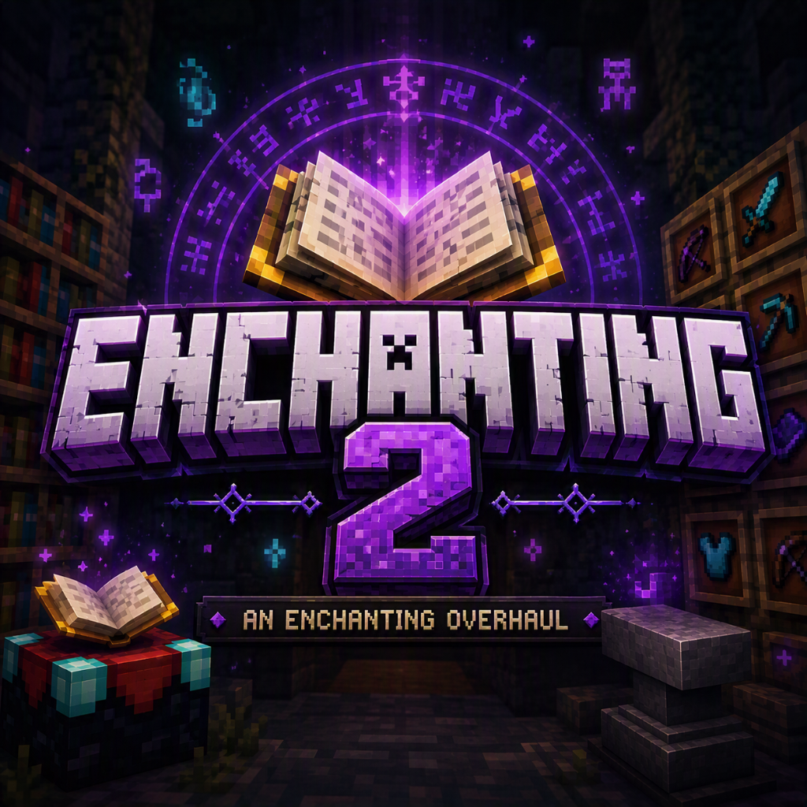

<p align="center"></p>

# Enchanting 2

[](https://github.com/Wulfic/enchanting-2/actions/workflows/ci.yml)
[](https://github.com/Wulfic/enchanting-2/releases/latest)
[](https://github.com/Wulfic/enchanting-2/wiki/Installation)
[](LICENSE)

A Fabric mod for Minecraft 1.21.11 that reworks XP and enchanting. You choose your enchantments instead of rolling
for them, you see every price before you pay, and an item can hold every enchantment that fits it. Every vanilla
enchantment is kept, 49 new ones are added, and almost everything can be configured in-game.

**[Download](https://github.com/Wulfic/enchanting-2/releases/latest)** ·
**[Wiki](https://github.com/Wulfic/enchanting-2/wiki)** ·
**[Report a bug](https://github.com/Wulfic/enchanting-2/issues/new/choose)**

## Features

**Experience**
- From level 30 on, every level costs the same 112 XP points (vanilla's cost of level 31) instead of more each time.
  There is no level cap.

**Enchanting table**
- Lists every enchantment that fits the item. Pick as many as you like (each starts at level I; the arrows raise it),
  and see the XP and lapis totals before you click Enchant. No random offers.
- Your armor and offhand slots are in the window, so worn gear can go straight onto the table (shift-click works).
- Bookshelves work as in vanilla: 15 shelves unlock every enchantment's top level, fewer shelves cap the levels.
  Mending and Frost Walker are offered too, with all 15 shelves.
- Accepts already-enchanted items and books, so you can add to them or raise their levels.

**Anvil**
- No 40-level "Too Expensive!" cap (a cap can be set in the config) and no cost that grows each time an item is
  worked.
- A breakdown beside the slots shows every price line, the total, and any book enchantment that won't apply and why.
- A book applies every enchantment the item can take. By default, the rest stay on the book.
- Anvils never wear out. Vanilla's chipping and breaking can be turned back on, and made rarer with a multiplier.

**Grindstone**
- Pick what to do: **Extract** one enchantment onto a plain book, **Cleanse** one curse, or Disenchant / Repair as in
  vanilla. Nothing happens until you pick, so a shift-click can't strip an item by accident.

**Costs**
- One clear rule prices the table and the anvil: 1 XP level per enchantment level by default (Sharpness V = 5).
  Upgrading pays only for the added levels. Single-level enchantments cost 10, Mending costs more on a heavily
  enchanted item (the table shows Mending's full price, with the other enchantments, on its row).
- Curses make enchanting cheaper: each curse on the item takes a share off the price, up to 45%. Removing a curse at
  the grindstone pays that discount back.

**Enchantments**
- Most vanilla enchantments go to level V (Protection V, Unbreaking V, Fortune V, Looting V and more).
- Vanilla's "can't be combined" rules are off by default, so Sharpness and Smite, Silk Touch and Fortune, all four
  Protections, Mending and Infinity can share an item. Each group can be turned back on.
- Fortune works on many more blocks (gravel's flint, clay, snow, mushroom blocks, leaves and more), but only on
  natural blocks: blocks you placed never get the bonus, so there's no place-and-mine loop.
- 49 new enchantments: armor (Vision, Calm Gaze, Health, Toughness, Double Jump, Lava Walking, Step Assist, Last
  Stand...), elytra (Speed, Flight), shields (Deflect, Shield Bash, Riposte, Spiked...), weapons (Vampirism,
  Beheading, Quick Strike, Withering...), tools (Area Mining, Smelting, Replant, Tiller, Magnetic, Reach...),
  Keep on Death for anything durable, and five curses that give a discount.
- Axes take Knockback, Looting and Fire Aspect. Crossbows take Flame and Infinity. Silk Touch picks up spawners.
  Infinity on a water or lava bucket gives 256 uses.
- Hold **Ctrl** over an item to see what each of its enchantments does, beside each name ("Efficiency V: ...") to
  keep the tooltip short. A tooltip taller than the screen scrolls with the mouse wheel.

**Other**
- An optional health multiplier for every mob (1x to 100x, off by default).

The full list, with max levels, prices and what each one fits: [Enchantments](https://github.com/Wulfic/enchanting-2/wiki/Enchantments)
(also in [docs/ENCHANTMENTS.md](docs/ENCHANTMENTS.md)). How each screen works, and how every price is worked out, is
on the [wiki](https://github.com/Wulfic/enchanting-2/wiki).

## Requirements

| | |
|---|---|
| Minecraft | Java Edition 1.21.11 |
| Loader | [Fabric Loader](https://fabricmc.net/use/) 0.19.5 or newer |
| Required | [Fabric API](https://modrinth.com/mod/fabric-api) |
| Optional | [Mod Menu](https://modrinth.com/mod/modmenu) and [YACL](https://modrinth.com/mod/yacl) for the in-game config screen |
| Java | 21 |

## Installing

Download `enchanting2-<version>.jar` from the [latest release](https://github.com/Wulfic/enchanting-2/releases/latest)
and put it and Fabric API in your `mods` folder.

**Multiplayer: install it on the server and on every player's client.** The new screens and Double Jump need the
client side. A player without the mod is turned away at join with a message naming it. A player with the mod who
joins a vanilla server gets vanilla screens and rules.

## Configuring

Settings live in `config/enchanting2/` and in the in-game screen (Mod Menu → Enchanting 2). The server's settings
apply to everyone and are sent to players when they join. Every enchantment can be turned off, kept out of the
table, loot or trades, repriced, and given a different max level (up to 255).

Every option, its default and how editing works on a server: [Configuration](https://github.com/Wulfic/enchanting-2/wiki/Configuration)
(also in [docs/CONFIG.md](docs/CONFIG.md)).

## Adding it to or removing it from a world

**Adding** to an existing world is safe. XP levels and items are kept as they are; only later levels cost
differently. Blocks placed before you installed it count as natural for Fortune.

**Removing it.** Back up the world first.
- **The 49 new enchantments are deleted from items** when a chunk or player loads without the mod. The items and their
  vanilla enchantments stay. A book holding only new enchantments becomes an empty enchanted book. Reinstalling won't
  bring them back.
- Vanilla enchantments above vanilla's max (Protection V) stay on items and keep working.
- Mobs multiplied by the health multiplier stay multiplied (vanilla caps them at 1024 health). Set it to 1x and load
  the areas before removing the mod to undo it.
- XP levels stay as they are. Only the curve goes back to vanilla.

## Building from source

```sh
./gradlew build                        # every version: jars in versions/<version>/build/libs/, unit + server GameTests
./gradlew :1.21.11:runClientGameTest   # client screen tests for one version (opens a game window)
./gradlew :1.21.11:runClient           # a development client (or :26.1.2:, :26.2:)
```

Gradle needs **JDK 25** to run (Fabric Loom requires it); the mod is compiled for Java 21 on 1.21.11 and Java 25 on
26.x, and Gradle downloads a missing JDK. The design spec is [docs/DESIGN.md](docs/DESIGN.md); changes are in [CHANGELOG.md](CHANGELOG.md).
Tests, CI and how releases are made: [Building from Source](https://github.com/Wulfic/enchanting-2/wiki/Building-from-Source).

## Contributing

Bug reports, balance feedback and pull requests are welcome: [open an issue](https://github.com/Wulfic/enchanting-2/issues/new/choose).
For a pull request, keep it small, add a test that fails without it, and run `./gradlew build` first.

## License

[MIT](LICENSE) © Wulfic. Modpacks are welcome to include it.
